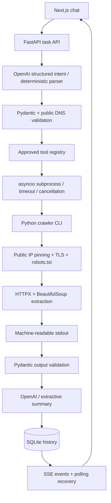

# AgentFlow

AgentFlow converts a natural-language website request into a real, approved Python CLI process. The chat shows source-grounded summaries, validated JSON, extracted pages, and the actual command, stdout, stderr, exit code, and timing. No API key is required for the basic workflow.

## Architecture



The frontend uses Next.js App Router, TypeScript, Tailwind CSS, a shadcn-style Radix Button, Lucide icons, Framer Motion, Markdown, syntax highlighting, and an expandable JSON viewer. FastAPI supplies OpenAPI docs and async lifecycle management; Pydantic validates intent and worker output. SQLite keeps task records across restarts. Each request gets a separate bounded Python worker, so the model never chooses executable commands.

## Prerequisites and installation

- Python 3.12 or later
- Node.js 22 LTS and npm
- Internet access to public websites, PyPI, and the npm registry
- Optional OpenAI API key for model interpretation and summaries

Run these commands from the repository root in **PowerShell**. `npm.cmd` works even when PowerShell script execution is disabled.

```powershell
python -m venv .venv
.\.venv\Scripts\python.exe -m pip install -r backend/requirements.txt
Copy-Item .env.example .env
cd frontend
npm.cmd ci
cd ..
```

On macOS/Linux use `python3 -m venv .venv`, `.venv/bin/python`, and `npm` in place of the Windows commands. Python dependencies have compatible version bounds; the frontend includes a lockfile.

## Configuration

The backend loads `.env` from the repository root. Never put an API key in a `NEXT_PUBLIC_` variable.

| Variable | Default | Purpose |
| --- | --- | --- |
| `OPENAI_API_KEY` | empty | Optional server-side OpenAI key |
| `OPENAI_MODEL` | `gpt-4.1-mini` | Structured-output-capable model available to your account |
| `DATABASE_URL` | `sqlite:///./agentflow.db` | SQLite filename; only SQLite is supported |
| `MAX_CRAWL_PAGES` | `5` | Maximum pages/attempts, capped at 10 |
| `CRAWL_TIMEOUT_SECONDS` | `60` | Worker deadline, capped at 180 seconds |
| `FRONTEND_ORIGIN` | `http://localhost:3000` | Allowed direct browser CORS origin |
| `BACKEND_URL` | `http://127.0.0.1:8000` | Next.js server proxy target; set in the frontend process environment |

When OpenAI is configured, the app uses the Responses API with Pydantic structured outputs. Failure or refusal falls back to deterministic parsing/extractive summarization and is labelled in the execution record. Model-generated prose can still contain inaccuracies; inspect source pages. See [official OpenAI structured outputs documentation](https://developers.openai.com/api/docs/guides/structured-outputs).

## Start locally

Terminal 1, from the repository root:

```powershell
.\.venv\Scripts\python.exe -m uvicorn backend.main:app --host 127.0.0.1 --port 8000
```

Terminal 2:

```powershell
cd frontend
npm.cmd run dev -- --hostname 127.0.0.1
```

Open **http://127.0.0.1:3000**. API documentation is at **http://127.0.0.1:8000/docs**. Health is at `/api/health`. For a production frontend build, run `npm.cmd run build`, then `npm.cmd start -- --hostname 127.0.0.1`.

Keep the prototype bound to loopback: it is a single-user local application without authentication. Do not use multiple Uvicorn workers: in-memory subprocess ownership and cancellation require one backend process. Docker Compose is also provided (`docker compose up --build`), with loopback host ports and persistent SQLite storage; Docker itself must be installed.

## Mandatory demonstration

Enter this exact prompt:

> Crawl https://example.com, extract important information, give me a summary, and return JSON.

Watch the execution stages. A successful run shows **Example Domain**, actual text from the public page, a validated JSON record, and a real command with exit code 0. Review Summary, JSON, Execution logs, and Pages. Export JSON, reopen the task from history, or rerun it. If the site or network is unavailable, the task should visibly fail; do not present that as a successful demo.

Run the same worker directly, from the repository root:

```powershell
.\.venv\Scripts\python.exe -m backend.cli.site_crawler --url https://example.com --max-pages 5 --output json
```

JSON goes to stdout and diagnostics go to stderr. The backend uses the active Python executable with this argument array through `asyncio.create_subprocess_exec`.

## API

| Method | Route | Behavior |
| --- | --- | --- |
| POST | `/api/chat` | `{ "message": "Crawl https://example.com ..." }`; returns a queued task, HTTP 202 |
| POST | `/api/tasks` | Validated `Intent` object; HTTP 202 |
| GET | `/api/tasks` | Latest 100 task records |
| GET | `/api/tasks/{id}` | Current task, result, events, and execution |
| GET | `/api/tasks/{id}/events` | SSE `progress` events and final `done` record |
| POST | `/api/tasks/{id}/cancel` | Cancel actual execution and return task |
| GET | `/api/health` | Backend status and whether AI is configured |

Task statuses are `queued`, `running`, `completed`, `partial`, `failed`, and `cancelled`. Chat interpretation errors are recorded as failed tasks; request schema errors return 422. Unknown IDs return 404; exceeding four active tasks returns 429. After a backend restart, interrupted tasks become failed with a rerun explanation. SSE supports `Last-Event-ID`; the frontend also polls to recover from stream interruptions.

## Security and crawler behavior

- Only the `site_crawler` tool is registered. No shell execution, model-produced command, or user-provided executable is accepted by any endpoint.
- URLs permit HTTP/HTTPS and standard ports only; credentials, localhost, private, loopback, reserved, multicast, link-local, metadata, and IPv6 transition destinations are rejected.
- Each request, including redirects and robots.txt, resolves DNS and rejects the entire answer set if any address is unsafe. HTTPX connects to a validated literal IP while retaining original Host and TLS SNI/certificate verification. Automatic redirects and environment proxies are disabled. This prevents a second DNS lookup from bypassing the check.
- Redirects are bounded. Page redirects must stay on the starting hostname and pass destination robots policy **before the redirected page is fetched**.
- robots.txt denial is enforced. Missing robots files allow crawling; network errors, server errors, 429, 401, and 403 fail closed. Request spacing respects crawler delay up to ten seconds; longer delays are refused.
- HTML only, at most ten page attempts, depth two, bounded links, per-request deadlines, bounded body size, and bounded subprocess output. A page only appears in results after a successful fetch and meaningful extraction. A completed bounded crawl does not mean every page on the website was visited.
- Process output streams drain concurrently. Timeouts and cancellation terminate the worker process tree on Windows, or the process group on POSIX. The CLI launches no child tools and has no access to the OpenAI key through its inherited environment.
- Retrieved content is untrusted data. OpenAI receives no execution tools and has explicit instructions to ignore embedded page directives. Returned finding URLs must match actual crawled pages. Deterministic summaries quote extracted text. React escapes extracted content and Markdown does not enable raw HTML.
- Logs strip control sequences and redact known secret environment values. Website data, URLs, and exports can still contain sensitive material from the website itself; SQLite and exports are local plaintext.

## Tests

Deterministic tests (no public crawling):

```powershell
.\.venv\Scripts\python.exe -m pytest -q
```

Real public integration (API → worker subprocess → HTTPS → extraction → summary → SQLite):

```powershell
$env:AGENTFLOW_LIVE_TEST='1'
.\.venv\Scripts\python.exe -m pytest -q -m live
Remove-Item Env:AGENTFLOW_LIVE_TEST
```

Browser end-to-end, with both servers already running:

```powershell
cd frontend
npm.cmd exec playwright install chromium
npm.cmd run test:e2e
npm.cmd run typecheck
npm.cmd run build
```

The browser test sends the mandatory prompt through the UI, checks the real command and success result, downloads JSON, verifies local-address rejection, and exercises mobile settings. It requires live public network access for its successful crawl. Screenshots go to ignored `frontend/test-results/`. See `VERIFICATION.md` for actual execution results and any environment limitations.

## Project layout

```text
backend/
  main.py              REST APIs, SSE, lifecycle
  manager.py           Task orchestration and progress
  runner.py            Approved argv, capture, timeout, process termination
  security.py          URL policy, public DNS resolution, pinned requests
  crawler.py           robots, traversal, HTML extraction
  cli/site_crawler.py  Real command-line entry point
  ai.py                Structured interpretation and grounded summarization
  models.py            Pydantic schemas
  config.py            Environment configuration
  store.py             SQLite persistence
  tests/               Deterministic and opt-in live tests
frontend/
  app/                 Next.js chat and responsive styling
  components/          Execution timeline, results, JSON tree, UI button
  types/               Task data contracts
  tests/               Playwright browser tests
.env.example
docker-compose.yml
DEMO_SCRIPT.md
SUBMISSION_CHECKLIST.md
VERIFICATION.md
```

## AI assistance disclosure

Developed with the OpenAI Codex coding agent for implementation, test authoring, documentation, and debugging. Optional runtime intelligence uses the OpenAI API with the configured model; no other AI provider is required. The no-key demonstration uses a deterministic intent parser and extractive summaries, and does not claim an LLM was used. No secrets are included. No video recording or deployed URL is claimed.

## Limitations and next steps

This is a local hackathon prototype: one task per conversation, one backend process, no authentication or distributed job queue, and no task recovery after a restart. It fetches server-rendered HTML, not JavaScript applications, PDFs, logged-in pages, or arbitrary files. Cloudflare/bot challenges can block extraction. It does not execute page scripts. Semantic focus instructions improve OpenAI summaries; deterministic summaries use page excerpts and headings rather than advanced custom extraction. It does not guarantee factual correctness of model prose. HTTP/S standard ports and conservative robots handling intentionally restrict some sites. Docker configuration is provided but must be verified on a machine with Docker.

Future extensions include isolated container workers with network egress policies, authenticated workspaces, a durable queue, robots caching/rate limits across tasks, PDF processing, schema-directed field extraction, and additional explicitly registered CLI tools.
